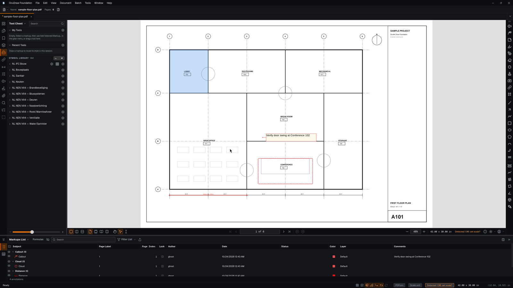
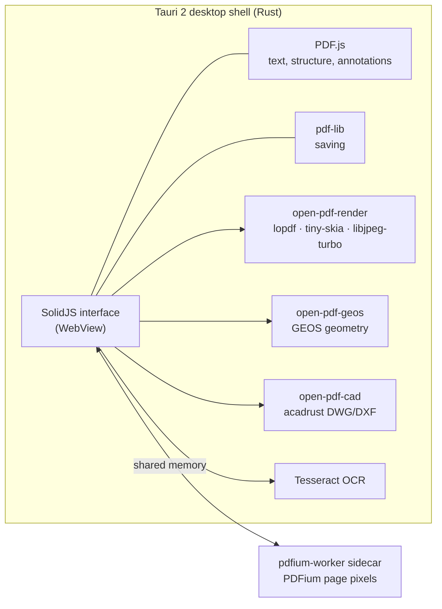

<p align="center">
  <a href="https://oculith.io"></a>
</p>

<h1 align="center">Oculith Draw · Foundation</h1>

<p align="center">
  <strong>Free, open-source construction drawing review.</strong><br>
  Open construction PDFs, mark them up, measure them and compare revisions, on your own machine.
</p>

<p align="center">
  <a href="https://oculith.io">oculith.io</a> ·
  <a href="docs/GUIDE.md">User guide</a> ·
  <a href="docs/README.md">Documentation</a> ·
  <a href="docs/CREDITS.md">Credits</a> ·
  <a href="docs/BUILDING.md">Build</a>
</p>

---

**Oculith Draw Foundation** is the free edition of the desktop drawing tool from [Oculith](https://oculith.io). It is the full drawing and review tool, licensed under the LGPL-3.0. It needs no account, no subscription and no network connection. It is built on [Open PDF Studio](https://github.com/OpenAEC-Foundation/open-pdf-studio), the open-source PDF editor by the [OpenAEC Foundation](https://github.com/OpenAEC-Foundation), and uses [GEOS](https://libgeos.org) for its area geometry: polygon unions, holes and offsets.

This repository, [GhostTekz/oculith-foundation](https://github.com/GhostTekz/oculith-foundation), is its published source. Each release carries a CycloneDX bill of materials (`SBOM.cdx.json`) of every locked dependency.

## Documentation

| Document | What it covers |
|---|---|
| [User guide](docs/GUIDE.md) | Every part of the app, tool by tool: documents and sheets, markups, the Tool Chest, the Markups List, measuring, compare, raceways, spaces, layers, OCR, CAD, print and preferences |
| [Architecture](docs/ARCHITECTURE.md) | How the app is built: the Tauri shell, the interface, the PDF renderers, the native crates, and the save/reopen contract |
| [Add-ons](docs/ADDONS.md) | The versioned local add-on interface, including independent packages and their build and install tools |
| [File format](docs/FILE-FORMAT.md) | What Oculith Draw stores in a PDF and how other readers see it |
| [Building](docs/BUILDING.md) | Building from source on Linux, Windows and macOS |
| [Credits](docs/CREDITS.md) | The open-source projects it is built on |
| [All documents](docs/README.md) | The documentation index |
| [Contributing](CONTRIBUTING.md) | Issues, pull requests and how releases reach this repository |

## Screenshots

<p align="center"></p>

## What it does

- **Sheets and sets.** Open PDF drawings in tabs with thumbnails, bookmarks and layers. Register every page as a sheet, record revisions, relink moved files after a fingerprint check, and publish the current set as one PDF in sheet order.
- **Markups.** Lines, arrows, boxes, clouds, callouts, text, highlights, counts, stamps and an offline library of construction symbols, with a contextual properties bar. Tool Chest presets, sequences, hot keys and Drawing Mode make repeated work fast.
- **Markups List.** A searchable, sortable spreadsheet of every markup, with layers, status, and document-backed Text, Choice, Number, Checkmark and Formula columns. Edit comments and custom columns in place. Export CSV or a PDF summary.
- **Measuring.** Length, polylength, area, perimeter, angle and count against a calibrated scale, with the title-block scale detected and offered. Show results in any unit, imperial or metric. The measurement itself never changes, only how it is shown.
- **Compare.** Side-by-side or overlaid revisions with confirmed page pairs, a change list, and CSV/PDF reports. Turn detected changes into editable markups.
- **Raceways.** Conduit and cable-tray runs with standard elbows, pull points, risers, a raceway schedule, bend totals and fill aids.
- **Spaces, layers, schedules.** Name spaces, sort markups into layers, and place quantity schedules on the sheet as tables.
- **OCR and CAD.** Add a text layer to scanned sheets with Tesseract, and import DWG/DXF geometry.

Everything is saved in the PDF itself, as standard annotations, so your markups open in other PDF readers too.

For teams, the [Oculith platform](https://oculith.io) connects drawings to the work in the field.

## Engineering choices

- **Local-first.** The PDF on disk is the source of truth. Markups, layers and custom columns are written into the file itself, so nothing is held in a hidden database.
- **Tauri 2 over Electron.** The system WebView and a Rust core keep the installer small and memory low. Native work (rendering, geometry, CAD, OCR) is Rust.
- **Three PDF engines, each where it is strongest.**
  - PDFium draws the pixels, so the page looks as it does in a mainstream reader.
  - PDF.js reads text, structure and annotations.
  - pdf-lib writes saves, so existing objects stay untouched.
  - PDFium runs in a separate worker process, so a broken PDF can't take down the app.
- **Page coordinates everywhere.** Geometry is stored in PDF page space. Crop box and rotation conversions are part of the save/reopen contract, so a markup lands in the same place on a rotated or cropped sheet.
- **Exact measuring.** Measurements are computed from page geometry and the calibrated scale, with no snapping or silent rounding. Display units and precision only change how a value is shown.
- **Reproducible source.** Every release carries an SBOM of every locked Cargo and npm dependency.
- **A considered design.** Oculith's design tokens give small radii, a dark and a warm-light theme, and Lucide icons. The PDF sheet stays neutral white.



| Path | What it is |
|---|---|
| [`open-pdf-studio/`](open-pdf-studio/) | The desktop app: the SolidJS interface in `js/`, styles in `styles/`, and the Tauri shell in `src-tauri/`. The directory name is inherited from the upstream project. |
| [`pdfium-worker/`](pdfium-worker/) | A sidecar process that renders page pixels with PDFium. |
| [`open-pdf-render/`](open-pdf-render/) | A Rust renderer for fast previews and print paths. |
| [`open-pdf-geos/`](open-pdf-geos/) | The bridge to the GEOS geometry library: unions, holes, offsets. |
| [`open-pdf-cad/`](open-pdf-cad/) | DWG/DXF import. |
| [`ocg-render-copy/`](ocg-render-copy/) | Optional content (PDF layers) handling for rendering and copies. |

## Built on open source

Oculith Draw stands on the work of these projects. Thank you.

| Project | Used for | Licence |
|---|---|---|
| [Open PDF Studio](https://github.com/OpenAEC-Foundation/open-pdf-studio) (OpenAEC Foundation) | The upstream PDF editor this application grew from | LGPL-3.0 |
| [Tauri](https://tauri.app) | Desktop shell, windows, filesystem, updater | Apache-2.0 / MIT |
| [SolidJS](https://www.solidjs.com) | Reactive interface | MIT |
| [PDFium](https://pdfium.googlesource.com/pdfium/), via [pdfium-render](https://github.com/ajrcarey/pdfium-render) and [@embedpdf/pdfium](https://github.com/embedpdf/embed-pdf-viewer) | Page rendering | BSD-3-Clause; MIT / Apache-2.0; MIT |
| [PDF.js](https://mozilla.github.io/pdf.js/) | Text, structure and annotation reading | Apache-2.0 |
| [pdf-lib](https://pdf-lib.js.org) and [fontkit](https://github.com/Hopding/fontkit) | Saving PDFs, embedding fonts | MIT |
| [lopdf](https://github.com/J-F-Liu/lopdf) | PDF object access in Rust | MIT |
| [tiny-skia](https://github.com/RazrFalcon/tiny-skia) | 2D rasterising in the Rust renderer | BSD-3-Clause |
| [libjpeg-turbo](https://libjpeg-turbo.org), via [turbojpeg](https://github.com/honzasp/rust-turbojpeg) | JPEG decoding | BSD-3-Clause / IJG / zlib |
| [ttf-parser](https://github.com/RazrFalcon/ttf-parser) and [hayro-font](https://github.com/LaurenzV/hayro) | Font parsing | MIT / Apache-2.0 |
| [GEOS](https://libgeos.org) | Polygon unions, holes, offsets | LGPL-2.1 |
| [Tesseract](https://github.com/tesseract-ocr/tesseract) and [Leptonica](http://www.leptonica.org) | OCR of scanned sheets | Apache-2.0; BSD-2-Clause |
| [acadrust](https://crates.io/crates/acadrust) | DWG/DXF import | MPL-2.0 |
| [i18next](https://www.i18next.com) | Translations | MIT |
| [Lucide](https://lucide.dev) | Icons (vendored) | ISC |
| [image](https://github.com/image-rs/image), [serde](https://serde.rs), [reqwest](https://github.com/seanmonstar/reqwest), [RustCrypto](https://github.com/RustCrypto) | Images, data, HTTPS, signatures | MIT / Apache-2.0 |

`SBOM.cdx.json` lists every locked dependency, including platform alternatives. The full third-party notices ship with the app under `notices/`; their source is `open-pdf-studio/src-tauri/package-notices/`.

## Build from source

The full guide is [docs/BUILDING.md](docs/BUILDING.md). You need Node.js 26 (pdfjs-dist 6.3 needs Node 25 or later), stable Rust, and the platform libraries for Tauri 2. On Debian or Ubuntu, those are `libwebkit2gtk-4.1-dev`, `libappindicator3-dev`, `librsvg2-dev`, `patchelf`, `libtesseract-dev`, `libleptonica-dev`, `cmake`, `nasm` and `pkg-config`.

```bash
cd open-pdf-studio
npm ci
npm run tauri:community -- --no-bundle   # native build, output in target/community
npm run build                            # frontend only
```

- Checks: `npm run typecheck`, `npm run test:unit` and `npx vite build --logLevel error`.
- The `mcpb/manifest.json` and `mcp-stdio/tools.json` files are MCP tool contract fixtures. The separately packaged Claude extension is not part of this source.
- Branded drawing templates are left out; add your own title blocks.

## Licence

- Oculith Draw Foundation is licensed under the [GNU Lesser General Public License v3.0](LICENSE.md).
- Third-party components keep their own licences, listed above and in the bundled notices.
- Oculith and the Oculith logo are trademarks of Oculith.

<p align="center"><a href="https://oculith.io"></a><br><sub>Made by <a href="https://oculith.io">Oculith</a></sub></p>
