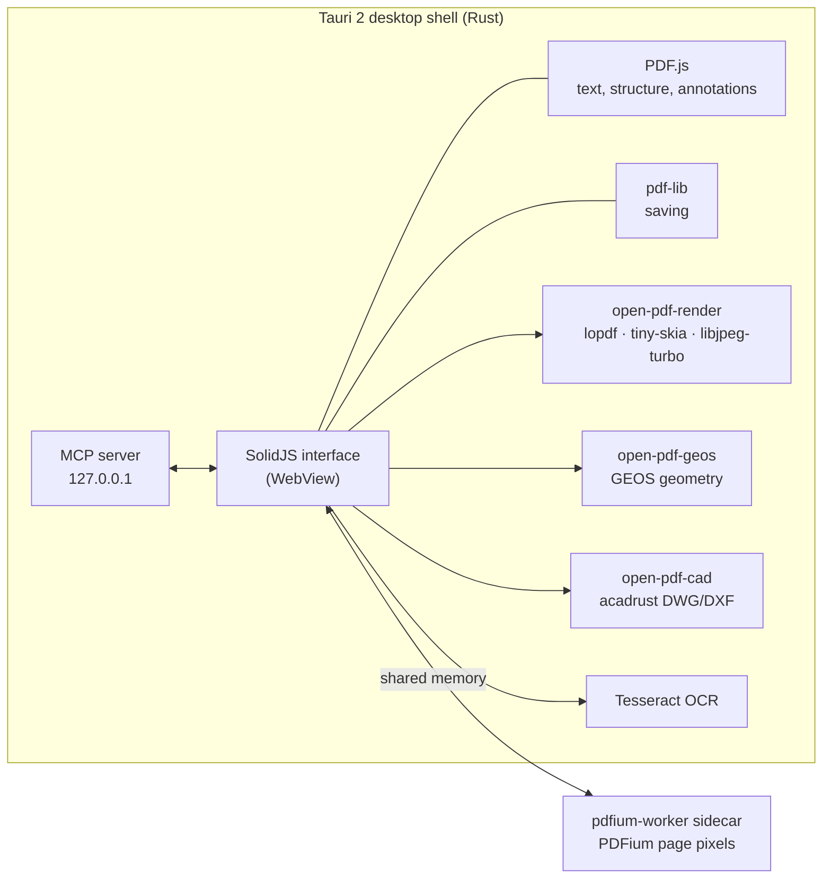

# Architecture

This page describes how Oculith Draw Foundation is built: the desktop shell, the interface, the PDF stack, the native crates, and the rules that keep a saved file correct. For build steps, see [Building from source](BUILDING.md). For the data written into a PDF, see [File format](FILE-FORMAT.md).

## Overview

- **Local-first.** The PDF on disk is the source of truth. Markups, layers, custom columns and spaces are written into the file itself. There is no hidden database.
- **One job per PDF library.** PDFium draws the pixels, PDF.js reads text, structure and annotations, and pdf-lib writes the saved file.
- **Native work in Rust.** Rendering, geometry, CAD exchange, OCR, printing and file access run in the Rust shell or in separate crates.

## Optional add-ons

Foundation contains the editor and the neutral add-on interface. The startup loader in `js/boot.js` asks the native shell whether a local add-on is installed. An installed add-on receives the versioned host interface in `js/plugin/host.js` and can register commands, panels, dialogs, templates and document hooks. The contract in `js/editions/contract.js` supplies empty defaults, so Foundation starts and works with no add-on. The native helper bridge can connect a separately installed helper process; Foundation does not ship a helper implementation.

Add-on code runs with the editor's privileges. Install only packages from a source you trust. The public interface is a compatibility contract, not a security sandbox. Foundation's source and installers contain no optional product implementation.

## Desktop shell: Tauri 2

The app is a Tauri 2 program. The shell (`open-pdf-studio/src-tauri/`) is Rust and hosts the interface in the system WebView.

- Tauri plugins provide windows, dialogs, the file system, the shell, the clipboard, deep links, single-instance handling and a settings store.
- The shell registers the native commands the interface calls with `invoke`: page renders, cache invalidation, atomic file writes, OCR, CAD import and export, printing and printer queries, URL downloads, file associations and startup diagnostics.
- File writes go through an atomic write: a temporary file, then a rename. A reader never sees half a file.
- A document can be detached into its own window. Each window process namespaces its render workers by process id, so they do not collide.

## Interface: SolidJS

The interface (`open-pdf-studio/js/`) is SolidJS, built with Vite.

- **Command registry** (`js/solid/commands/registry.js`). Every menu item, toolbar button and registry shortcut is a command with an id such as `file.open` or `view.fitPage`, an i18n label key, an icon, an `enabled` and optional `checked` state, and a `run` function. Menus (`commands/menus.js`) and toolbars are lists of command ids. **Find Tools + Commands** searches the registry.
- **Workspace layout** (`js/solid/stores/workspaceLayout.js`). One serialisable layout holds the three panel hosts (left, right, bottom), their tabs, sizes and collapsed state, and which toolbars show. Profiles are default layouts. The layout is saved in the preferences.
- **Panel registry** (`js/solid/components/panels/panelRegistry.js`). One entry per panel: title, icon, shortcut, a lazily loaded body component and the panel menu.
- **Shortcut table** (`js/tools/shortcut-table.js`). One table of every key binding. The keyboard handler dispatches from it, the F1 dialog lists it, and a test checks it for clashes.
- **Tools** (`js/tools/tools/`). Each canvas tool is registered in `tools/tools/index.js` and receives pointer and key events from the tool manager.
- **Translations** use i18next, with English strings in `js/i18n/locales/en/`.
- **Styles** (`open-pdf-studio/styles/`) use the Oculith design tokens (`--ox-*`): small radii, a dark and a light theme, and vendored Lucide icons. The PDF sheet stays neutral white.

The page view keeps four fixed elements that the renderer depends on: `#pdf-container`, `#canvas-wrapper`, `#pdf-canvas` and `#annotation-canvas`. The PDF is painted on one canvas and the markups on a canvas above it.

## PDF stack

### PDFium in the `pdfium-worker` sidecar

PDFium draws page pixels, so a sheet looks as it does in a mainstream reader. It runs in a separate process, `pdfium-worker`, so a broken PDF cannot take down the app.

- The shell starts a pool of workers. Each worker uses `pdfium-render` and creates a 64 MB memory-mapped file for its output.
- Requests and replies are JSON lines on the worker's stdin and stdout. The pixels go through the shared memory, not the pipe.
- Routing keeps each page on the same worker (a hash of path and page), so heavy CAD pages stay parsed in one warm worker. Cheap pages can overflow to the least-busy worker.
- Cache invalidations go ahead of renders. A crashed or timed-out worker is stopped and replaced.
- After a save, the shell evicts that path from its own caches and asks each worker to do the same, and waits for every worker to confirm before it reports success. A worker that does not confirm is restarted.
- Large zoomed pages are drawn as tiles. Progressive rendering fills heavy drawings tile by tile.
- When the pool is not ready, the shell falls back to PDFium in its own process.
- `ocg-render-copy` makes a render-only copy of a PDF's optional-content configuration. It never writes a PDF path; the original file stays the source of truth.

In the browser preview (`npm run dev`), PDFium runs as WebAssembly through `@embedpdf/pdfium`, or PDF.js draws the page.

### PDF.js for text and structure

PDF.js (`pdfjs-dist`) reads the document: text content for search, selection and OCR checks; the annotation list the loader converts into markups; outlines, page labels, links, form fields and structure tags; and the operator list that supplies vector geometry for snapping and Dynamic Fill. The passive pane of a split view also renders with PDF.js.

### pdf-lib for saving

pdf-lib writes the saved file. The saver (`js/pdf/saver.js` and `js/pdf/saver/`) loads the original bytes, rewrites the annotations of each page, writes the catalog entries, and leaves every other object as it was. fontkit embeds fonts for text appearances.

### open-pdf-render

`open-pdf-render` is a pure-Rust page renderer. It parses PDFs with lopdf, rasterises with tiny-skia, decodes JPEG with libjpeg-turbo (through `turbojpeg`) and parses fonts with ttf-parser and hayro-font. The app uses it for scene tiles of dense vector sheets and for some preview and print paths. PDFium stays the default page renderer. The status bar names the renderer that drew the current view.

### open-pdf-geos

`open-pdf-geos` calls GEOS 3.14.1 through its C API, in the shared library `libgeos_c`. It is linked only in a build with `--features geos`; see [Building](BUILDING.md#optional-geos-geometry).

- The geometry is PDF user space: origin at the bottom left, y up, before display rotation.
- Each thread that calls the crate gets its own GEOS context.
- Stored results ask GEOS once, after an edit is committed: the net area of an area measurement (union of its parts minus its holes, with self-crossing rings repaired), polygonal areas, schedule totals where shapes overlap, a committed offset, trim and split crossings, whether a count lies in its space, and a Dynamic Fill polygonize.
- Live values stay in JavaScript: the number shown while the pointer moves, snapping, hit testing, previews and raceway strokes. GEOS is never called on a pointer move.
- Without the feature, the commands report that GEOS is absent and the JavaScript results stand.

GEOS is LGPL-2.1-only and stays a separate shared library beside the program, so it can be replaced.

### open-pdf-cad

`open-pdf-cad` exchanges CAD drawings through one geometry model.

- **Export**: PDFium page objects are extracted in PDF user space, converted to a drawing in millimetres with layers and line types, and written to DXF (text or binary) or DWG by acadrust.
- **Import**: a DWG or DXF drawing is read by acadrust and written as a PDF page to scale, with layers as optional content and a measuring scale.

### OCR

OCR uses Tesseract and Leptonica through `tesseract-rs`. On Linux it links the system libraries; on Windows and macOS it builds them from source. Trained data for English and Traditional Chinese and a CJK font for the text layer are downloaded and checked by SHA-256 at build time (`scripts/ocr-runtime.mjs`). OCR writes an invisible text layer into the page. Auto-detect picks the language per page.

## Coordinates

All markup geometry is stored in **page coordinates**.

- **Annotation space** (the model): page points (1/72 in), measured from the top left of the visible page (the CropBox), y down, with the page's `/Rotate` and the app's own page rotation applied. Pointer input, snapping, the vector segments from PDF.js, Dynamic Fill and Visual Search all use this space, so they need no extra conversion.
- **PDF user space** (the file): origin at the bottom left of the default user space, y up, without `/Rotate`. The saver maps every point from annotation space to user space with one point mapper, including the CropBox offset and the rotation. The loader maps back.
- **View**: screen pixels at the current zoom and view rotation. View rotation never changes stored geometry.

A markup therefore lands in the same place on a rotated or cropped sheet, after save and reopen, and in another reader. The round-trip tests cover `/Rotate 90` and `/Rotate 270` pages with an offset CropBox.

Measurements are computed from page geometry and the calibrated scale, with no silent rounding. The scale at a point comes from, in order, a scale region or viewport under it, a scale bar, a PDF viewport, or the page or document scale. Display units only change the text.

## Save and reopen contract

1. **The file holds everything.** Every markup is a standard PDF annotation with an appearance stream. App data that a standard key cannot hold goes into private `OPS_*` keys on the annotation, the page or the catalog.
2. **Untouched objects stay the same.** A markup the app did not change, including one written by another program, keeps its object, its appearance and every key, byte for byte.
3. **Edited markups keep their identity.** A changed markup is written at its original object number and position in `/Annots`. Group links, replies and pop-ups keep pointing at it. Keys the app does not own are carried over.
4. **Durable ids and stable names.** Rectangles, ellipses, lines and arrows carry a durable id (`OPS_MarkupIdV1`) that survives save and reopen, so slip-sheet records can name their source. Every written markup also has an `/NM` name that is kept from the file or created once.
5. **Unread data is kept.** When the loader has not yet read part of a file (spaces, viewports, tool sequence counters, catalog metadata), a save keeps the file's entries instead of dropping them.
6. **Bounded, validated input.** PDFs are untrusted. Private keys are size-limited and validated on read; malformed values are ignored, not trusted.
7. **Atomic write and cache eviction.** The new bytes are written atomically, then every render cache for that path is evicted before the save reports success.

## Automation: MCP bridge

The shell contains an MCP server (`src-tauri/src/mcp_server.rs`) that speaks JSON-RPC over HTTP on `127.0.0.1` (port 9223 by default). **Preferences ▸ General ▸ AI link (MCP)** turns it on and off and sets the port. It listens only on the local machine.

- `mcp_app_bridge.rs` forwards each tool call to the WebView as an event; `js/mcp-bridge.js` runs the action in the app and returns the result.
- The public tools open, navigate and zoom documents, take screenshots of the view, create, list, update and delete annotations, set the measure scale, place schedules, work with layers, snippets, CAD import and export, printing, tabs and saving.
- `app_list_commands` and `app_run_command` expose every command in the registry.
- The tool contract is published as `mcp-stdio/tools.json` and `mcpb/manifest.json`.

## Repository map

| Path | What it is |
|---|---|
| `open-pdf-studio/` | The desktop app. The directory name is inherited from the upstream project. |
| `open-pdf-studio/js/` | The SolidJS interface: `solid/` (components, commands, stores), `pdf/` (loader, saver, renderer, exporters), `annotations/` (markup model and drawing), `tools/` (canvas tools, snapping, shortcuts), `compare/`, `sets/`, `spaces/`, `batch/`, `quantities/`, `symbols/`, `i18n/`. |
| `open-pdf-studio/styles/` | Stylesheets and the Oculith design tokens. |
| `open-pdf-studio/src-tauri/` | The Tauri shell: Rust commands, the worker pool, OCR, printing, CAD commands, the MCP server, the bundle configuration and the third-party notices (`package-notices/`). |
| `open-pdf-studio/scripts/` | Build helpers, runtime downloads and the unit-test runner. |
| `pdfium-worker/` | The sidecar process that renders page pixels with PDFium into shared memory. |
| `open-pdf-render/` | The pure-Rust page renderer (lopdf, tiny-skia, libjpeg-turbo). |
| `open-pdf-geos/` | The GEOS bridge: unions, holes, offsets, crossings, polygonize. |
| `open-pdf-cad/` | DWG/DXF import and export on acadrust. |
| `ocg-render-copy/` | Render-only copies of a PDF's optional-content (layer) configuration. |
| `mcp-stdio/` | `tools.json`: the MCP tool contract fixture. |
| `mcpb/` | `manifest.json`: the MCP bundle manifest fixture. |
| `docs/` | This documentation. |

Every release carries a per-file SHA-256 manifest (`SOURCE-MANIFEST.json`) and a CycloneDX bill of materials (`SBOM.cdx.json`) of every locked Cargo and npm dependency.
